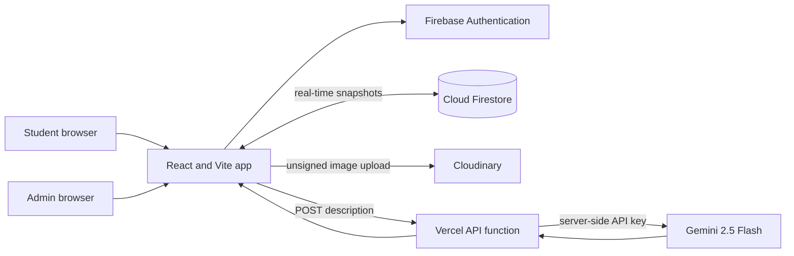

# CampusFix Lite

CampusFix Lite is a campus complaint management MVP. Students can submit and track facilities reports; administrators can review, prioritize, and move reports through a controlled status workflow.

## Features

- Email/password authentication with student and invite-gated admin roles.
- Student-only complaint creation and real-time personal complaint lists.
- Optional JPG/PNG attachments uploaded directly to Cloudinary unsigned uploads.
- Debounced Gemini category suggestions with a local keyword fallback.
- Real-time admin charts, searchable and filterable complaint table, and status history.
- Role-aware routes, Firestore ownership rules, form validation, loading/empty states, toast feedback, and an error boundary.

## Stack

React 18, Vite, React Router 6, Tailwind CSS, Firebase Authentication, Firestore, Cloudinary, a Vercel serverless function, Gemini 2.5 Flash, lucide-react, Recharts, and react-hot-toast. Firebase Storage and Cloud Functions are not used.

## Architecture



The browser reads the Firebase project config and Cloudinary unsigned preset from `VITE_*` variables. The Gemini key is read only by `api/suggest-category.js` from the server-side `GEMINI_API_KEY` variable. When the API is unavailable, the browser classifies descriptions with `src/utils/categoryFallback.js`.

## Project Structure

```text
api/
	suggest-category.js
src/
	components/       shared layout, status, empty, loading, and error UI
	context/          Firebase-backed authentication provider
	hooks/            auth, Firestore subscriptions, and debounce hooks
	pages/
		admin/          admin overview, complaint table, complaint actions
		student/        student overview, report form, list, and detail
	services/         Firebase, complaint, and Cloudinary operations
	utils/            complaint data, category fallback, and auth errors
	App.jsx
	main.jsx
firestore.rules
firebase.json
.env.example
```

## Install

To scaffold a fresh copy with the same core stack:

```sh
npm create vite@latest . -- --template react
npm install react@18.3.1 react-dom@18.3.1 react-router-dom@6 firebase lucide-react react-hot-toast
npm install -D tailwindcss@3.4.17 postcss autoprefixer
npm install -D @types/react@18 @types/react-dom@18
npm install recharts
```

For this checked-out project, install the locked dependencies with `npm install`.

## Firebase Setup

1. Create a Firebase project on the free Spark plan.
2. In **Authentication → Sign-in method**, enable **Email/Password**.
3. Create a Cloud Firestore database.
4. In **Firestore → Rules**, paste the contents of `firestore.rules` and publish them. The matching `firebase.json` is also included for Firebase CLI use.
5. In **Project settings → General → Your apps**, register a web app and copy its Firebase config values into `.env.local` as shown below.
6. Choose a long demo invite string for `VITE_ADMIN_INVITE_CODE`, then restart Vite after changing environment values.

### Admin Provisioning Note

`VITE_ADMIN_INVITE_CODE` is included in browser JavaScript by design because the requested signup flow uses a `VITE_` variable. It is visible to every site visitor and is suitable only as a classroom/demo gate, not as a secret authorization mechanism. Firestore rules make a profile's role immutable after creation, but rules cannot verify a client-side invite code. For a real deployment, create the first admin account, then set that account's `users/{uid}.role` to `admin` in the Firebase console; do not treat a public invite string as production access control.

## Cloudinary Setup

1. Create a free Cloudinary account and note the **Cloud name**.
2. Open **Settings → Upload → Upload presets** and create an **unsigned** preset.
3. Restrict the preset to JPG/PNG and a 2 MB maximum where the account settings allow it. The app also validates those limits before upload.
4. Put the cloud name and preset name in `.env.local`. No Cloudinary secret is sent to the browser.

## Gemini Setup

1. Create a Gemini API key in Google AI Studio using its free-tier quota.
2. Set `GEMINI_API_KEY` in the local server environment and in Vercel's server-side environment settings. Do not rename it with a `VITE_` prefix.
3. `npm run dev` starts Vite only. The client fallback still works, but Vite does not execute Vercel functions. Use `npx vercel dev` to exercise `/api/suggest-category` locally; deploy to Vercel to run the function in production.

## Environment Variables

Copy `.env.example` to `.env.local` and fill in the values. Vite exposes only variables prefixed with `VITE_` to browser code.

| Variable | Used by | Notes |
| --- | --- | --- |
| `VITE_FIREBASE_API_KEY` | Browser | Firebase web app config; not an admin secret |
| `VITE_FIREBASE_AUTH_DOMAIN` | Browser | Usually `<project-id>.firebaseapp.com` |
| `VITE_FIREBASE_PROJECT_ID` | Browser | Firebase project ID |
| `VITE_FIREBASE_STORAGE_BUCKET` | Browser config | Included for the Firebase web config; this app does not use Firebase Storage |
| `VITE_FIREBASE_MESSAGING_SENDER_ID` | Browser config | Firebase web app config |
| `VITE_FIREBASE_APP_ID` | Browser | Firebase web app config |
| `VITE_CLOUDINARY_CLOUD_NAME` | Browser | Cloudinary account cloud name |
| `VITE_CLOUDINARY_UPLOAD_PRESET` | Browser | Unsigned preset name; keep the preset restricted |
| `VITE_ADMIN_INVITE_CODE` | Browser | Public demo gate only; never use as a production secret |
| `GEMINI_API_KEY` | Vercel function only | Server-side Google AI Studio key; never prefix with `VITE_` |

## Run Locally

```sh
npm install
cp .env.example .env.local
# Edit .env.local with Firebase and Cloudinary values.
npm run dev
```

Open the local URL printed by Vite. The landing page and auth forms run without configured keys; authentication and Firestore actions require Firebase setup. For the Gemini function, use `npx vercel dev` instead of `npm run dev`.

Useful checks:

```sh
npm run lint
npm run build
```

## Deploy to Vercel

1. Push this project to a Git provider and import it into Vercel.
2. Keep the framework preset as **Vite**. Vercel serves the Vite frontend and detects `api/suggest-category.js` as a serverless function.
3. Add all `VITE_*` values as Vercel project environment variables for the deployment environments you use. These are public client config values and are embedded during the build.
4. Add `GEMINI_API_KEY` as a server-side environment variable. Do not expose it to the frontend.
5. Deploy, then test `/`, sign-in, an authenticated student report, and `POST /api/suggest-category`.
6. Publish the Firestore rules from `firestore.rules` in Firebase. The static Vercel deployment does not publish Firebase rules automatically.

## Demo Script

These are sample credentials for accounts you create in your own Firebase project; no shared demo database is bundled.

| Role | Email | Demo password | Signup choice |
| --- | --- | --- | --- |
| Administrator | `admin.demo@example.com` | `CampusFixDemo!2026` | Administrator, with your configured invite code |
| Student | `student.demo@example.com` | `CampusFixDemo!2026` | Student |

1. Configure Firebase and the demo invite string, then create the administrator account first.
2. Sign in as the administrator and show the live status totals, category chart, and status chart.
3. Sign out and create/sign in as the student account.
4. Submit a report titled **Leaking tap near the library**, category **Other**, location **Library, first floor**, with a description that mentions the leak. The keyword fallback should suggest **Water**; the Gemini suggestion appears when the Vercel function is available.
5. Optionally attach a small JPG or PNG after Cloudinary is configured.
6. Return to the administrator account. The new report appears in the overview and complaint table without a refresh. Change its priority, approve it, and advance it to **In Progress**.
7. Return to the student account and show the live status update and timeline. Resolve it with a resolution remark. Use a separate report to demonstrate **Rejected**, since rejected and resolved are final states.
8. In the admin table, demonstrate search, status/category/priority filters, date range, priority sorting, and pagination.

## Workflow Rules

The allowed transitions are `Pending → Approved` or `Rejected`, `Approved → In Progress`, and `In Progress → Resolved`. Rejected and Resolved are final. The admin UI offers only valid next steps, and the Firestore rules validate transitions and require a remark for rejection or resolution. Students can read only their own complaints; deletes are denied.
